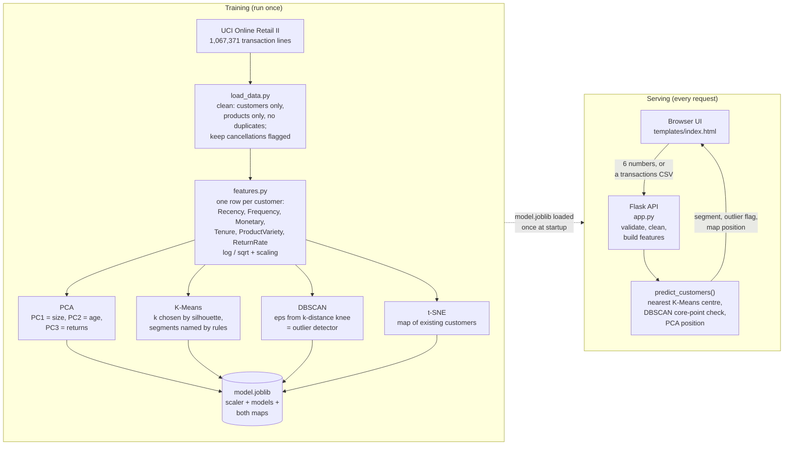
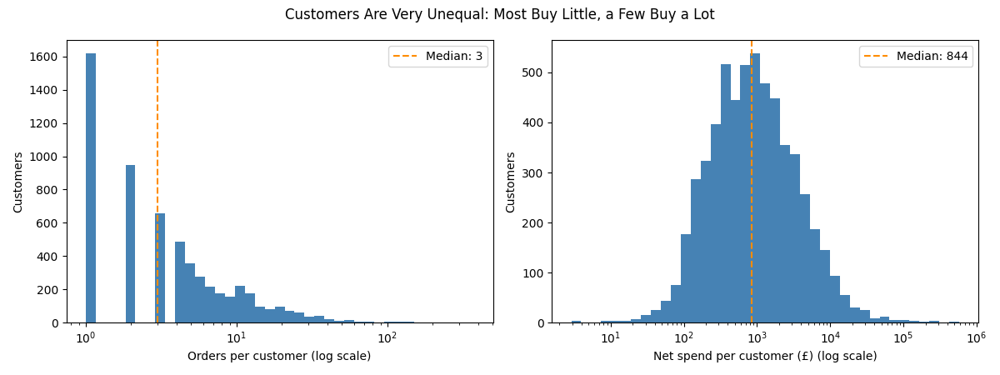
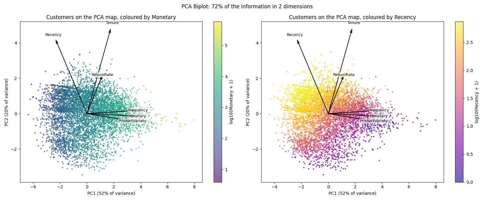
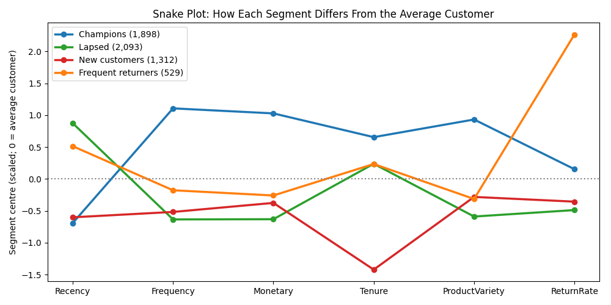
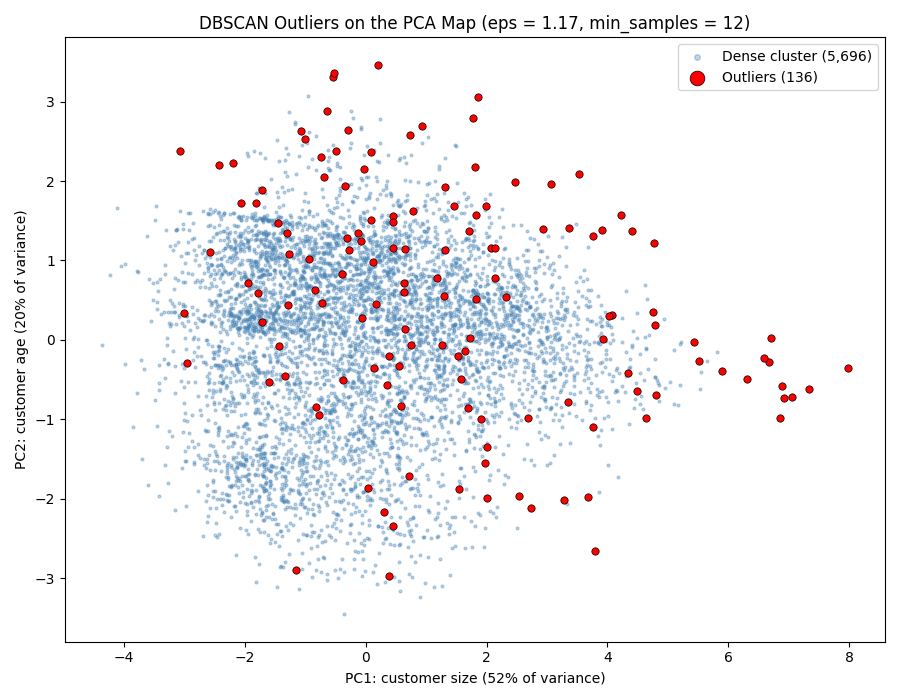
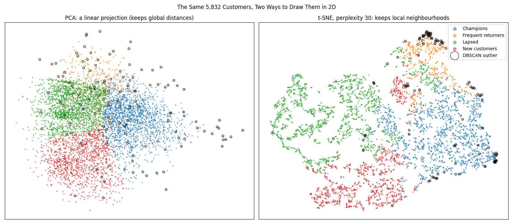

# Customer Segmentation

Segmenting the customers of a UK online gift shop from **1 million real transactions**, using four unsupervised learning techniques: **K-Means, DBSCAN, PCA and t-SNE**. It ends in a Flask web app that segments new customers and whole customer lists.

**Headline result:** 4 segments, found and named automatically. **Champions are 33% of customers but bring 83% of revenue.** DBSCAN flags 136 unusual customers (2.3%) who together bring 26% of revenue.

| Segment | Customers | Revenue | Median days since last order | Median orders | Median net spend |
|---|---|---|---|---|---|
| **Champions** | 32.5% | **82.9%** | 28 | 9 | £3,272 |
| **Lapsed** | 35.9% | 7.3% | 399 | 2 | £381 |
| **New customers** | 22.5% | 6.5% | 36 | 2 | £552 |
| **Frequent returners** | 9.1% | 3.4% | 255 | 3 | £711 |

---

## Project overview

**Training** runs once, offline: each step makes a decision the next one builds on. **Serving** runs every time someone uses the app: it only loads the saved model.



---

## How to run

```bash
pip install -r requirements.txt
python app.py
```

Then open http://localhost:5000. The trained model (`model.joblib`) and a sample CSV are included, so the app works straight after cloning.

To rebuild everything from the raw data, run the scripts in order. The first one downloads the dataset (about 45 MB from UCI, which can take several minutes) into `data/`, and every analysis script saves its plots into `plots/`.

```bash
python load_data.py          # Step 1: download + first look
python explore_data.py       # Step 2: cleaning + exploration (plots 1-4)
python feature_analysis.py   # Step 3: customer features (plots 5-7)
python pca_analysis.py       # Step 4: PCA (plots 8-10)
python kmeans_analysis.py    # Step 5: K-Means (plots 11-14)
python dbscan_analysis.py    # Step 6: DBSCAN (plots 15-18)
python tsne_analysis.py      # Step 7: t-SNE (plots 19-21, about 5 minutes)
python train_final_model.py  # Step 8: rebuild model.joblib
python make_sample.py        # optional: rebuild samples/sample_transactions.csv
```

| File | What it does |
|---|---|
| `load_data.py` | Downloads and caches the data as Parquet; `clean_data()` |
| `features.py` | Transactions → one row per customer; the scaler; `load_customer_features()` |
| `training.py` | The reusable procedure: choosing k, naming segments, stability, `eps`, outlier check, t-SNE, `predict_customers()` |
| `explore_data.py` … `tsne_analysis.py` | One analysis script per step, each with its plots and printed findings |
| `train_final_model.py` | Rebuilds the model, compares it with the saved one, saves `model.joblib` |
| `app.py`, `templates/index.html` | The Flask API and the web UI |
| `make_sample.py`, `samples/` | A small real-transactions CSV for trying the upload |

---

## Step 1–2: Data and cleaning

[UCI Online Retail II](https://archive.ics.uci.edu/dataset/502/online+retail+ii): every transaction of a UK online gift shop from 1 Dec 2009 to 9 Dec 2011, about 1 million lines from 5,942 customers in 43 countries. Many customers are wholesalers.

| Cleaning step | Rows left |
|---|---|
| Raw data | 1,067,371 |
| Has a Customer ID (22.8% have none) | 824,364 |
| Exact duplicates removed | 797,885 |
| Real products only (no postage, fees, manual adjustments, vouchers) | 794,244 |
| Price > 0 | 794,183 |

**The key decision: cancellations are kept, flagged.** The two largest orders in the data (80,995 and 74,215 items) were **cancelled within 15 minutes**. Deleting only the cancellation lines would have made those two customers look like £168k and £77k spenders. Instead, spending is computed **net** (purchases − cancellations), and cancellations become a return-rate feature.

**What exploration showed**
- **Top 20% of customers bring 77% of net revenue**, close to the classic 80/20 rule.
- **Strong seasonality:** revenue and active customers nearly double every November.
- **Spend is extremely skewed:** from £3 to £578,000, with a median of £844.



---

## Step 3: Customer features

| Feature | Meaning | Transform | Skew before → after |
|---|---|---|---|
| Recency | Days since last order | log1p | 0.90 → −0.55 |
| Frequency | Number of orders | log1p | 12.0 → 1.0 |
| Monetary | Net spend (£) | log1p | 26.8 → 0.25 |
| Tenure | Days since first order | none (it's left-skewed) | −0.62 |
| ProductVariety | Different products bought | log1p | 6.2 → −0.26 |
| ReturnRate | Share of purchase value cancelled | sqrt (59% are exactly 0) | 7.5 → 2.5 |

After the transforms, every feature is standardized. **Kept for describing segments, not for clustering:**
- **AvgOrderValue** is redundant (see Step 4).
- **Country / IsUK** would split customers into "UK" and "not UK", which we know without machine learning.

---

## Step 4: PCA

| Component | Variance | Meaning (largest loadings) |
|---|---|---|
| PC1 | 52.1% | **Customer size**: Frequency, Monetary, ProductVariety |
| PC2 | 20.2% | **Customer age**: Tenure + Recency (long-time customers who stopped buying) |
| PC3 | 15.4% | **Returns**: ReturnRate (+0.93) |
| PC4–PC6 | 12.4% | |



**Lessons**
- **A near-zero component finds a redundant feature.** With AvgOrderValue included, the last component kept only **0.04%** of the variance. AvgOrderValue = Monetary ÷ Frequency, so after the log it's almost exactly log Monetary − log Frequency (**R² = 0.979**). It was dropped from clustering, which also stopped money being counted twice in every distance.
- **PCA axes can be interpreted,** which makes PCA useful for *explaining* segments.
- **A 2D map keeps 72% of the information.** The rest matters: some segments differ mainly on PC3.
- **There are no natural clusters.** The customers form one continuous cloud, so segmentation means cutting a continuum into useful pieces.

---

## Step 5: K-Means

| k | Silhouette ↑ | Davies-Bouldin ↓ |
|---|---|---|
| 2 | 0.316 | 1.227 |
| 3 | 0.282 | 1.281 |
| **4** | **0.299** | **1.178** |
| 5 | 0.264 | 1.150 |
| 6 | 0.252 | 1.186 |

**k = 4:** the best silhouette within k = 3–8. k = 2 scores highest overall, but "good customers vs the rest" is too coarse to act on. **Segments are named automatically** by rules on their centres, for example "average value above +0.5 SD and recent → Champions", so the names still work if the data changes.



**Lessons**
- **Profiling is the real output.** A cluster number means nothing until it's described in business terms.
- **A silhouette of 0.30 is normal for continuous customer data.** Frequent returners are the fuzziest segment (0.17).
- **Stability:** across 20 random 80% samples, the agreement with the full model (Adjusted Rand Index) averages **0.959**. One run fell to 0.544, because K-Means can land in a different local optimum.

---

## Step 6: DBSCAN

`min_samples = 12` (2 × 6 features). **`eps = 1.17`**, from the knee of the k-distance curve.

| eps | Clusters | Noise |
|---|---|---|
| 0.5 | 5 | 54% |
| 0.7 | 1 | 17% |
| **1.17** | **1** | **2.3%** |
| 2.0 | 1 | 0.1% |

**Lessons**
- **On this data DBSCAN is an outlier detector, not a segmenter.** For any reasonable `eps`, there's one dense cluster plus noise.
- **The "clusters" at small `eps` are artifacts:** piles of customers with exactly 1 order and 0 returns.
- **The 136 outliers are 2.3% of customers but 25.6% of revenue.** 69 are outliers because of extreme return rates, and others are giant accounts, like one with 145 orders and £578k net spend.
- **The returners segment depends on extreme customers.** Re-running K-Means without the outliers made "Frequent returners" disappear (agreement 0.513, silhouette 0.299 → 0.256). So the final model keeps outliers in K-Means and reports them separately.
- **DBSCAN has no `predict()`.** The app flags a new customer as an outlier when no core point is within `eps`, which reproduces DBSCAN's own labels exactly on the training data.



---

## Step 7: t-SNE



| | PCA | t-SNE |
|---|---|---|
| Trustworthiness (are neighbors on the map real neighbors?) | 0.913 | **0.996** |
| Distances between segments (rank correlation with real) | **0.77** | 0.71 |
| Spread of Frequent returners (real: 0.84) | 0.65 | **0.36** |

**Lessons**
- **t-SNE separates what PCA overlaps.** Returners get their own region, because t-SNE uses neighbors in all 6 dimensions.
- **But t-SNE distorts sizes and distances.** The most spread-out segment is drawn as the tightest. Read only "these points are neighbors" from it.
- **Perplexity and the random seed change the layout, not the quality.** All seeds give trustworthiness 0.996.
- **There's no `transform()`.** A new customer can't be added to a t-SNE map, so the app places new customers on the PCA map instead.

---

## Step 8: Automatic training pipeline

`train_final_model.py` rebuilds everything from the current data in about 70 seconds. **Nothing about the model is hardcoded:**

| Recalculated on every run | Fixed (human decisions, in `training.py`) |
|---|---|
| k (best silhouette), the segment names, DBSCAN `eps`, the scaler, both maps | The range of k (3–8), the naming rules, `min_samples` = 2 × features, the 6 features and their transforms |

It prints what changed from the saved model: k, silhouette, segment sizes, and **how many customers moved segment**. If fewer customers keep their segment than an Adjusted Rand Index of 0.5, it **won't save without `--force`**, because a big shift would change every marketing list built on the segments.

---

## Step 9: Web app

| Endpoint | What it does |
|---|---|
| `GET /` | The UI |
| `GET /api/overview` | Segments with profiles, suggested actions and model stats |
| `GET /api/map` | Every customer with PCA and t-SNE positions |
| `POST /api/predict` | 6 numbers → segment, outlier flag, PCA position, distance to each segment |
| `POST /api/predict-batch` | A raw transactions CSV (+ optional analysis date) → every customer segmented |
| `GET /api/sample` | The sample CSV |

```bash
curl -X POST http://localhost:5000/api/predict -H "Content-Type: application/json" -d "{\"Recency\": 10, \"Frequency\": 20, \"Monetary\": 8000, \"Tenure\": 600, \"ProductVariety\": 200, \"ReturnRate\": 0.01}"
```

**What the UI offers**
- **Segment overview** with suggested actions.
- **An interactive customer map** with an animated t-SNE ↔ PCA toggle. Hover or tap a dot for its numbers, click a segment to hide it, and outliers are ringed.
- **Score a customer:** the new customer appears as a ★ on the PCA map.
- **Upload a CSV of transactions:** see the segments, then download them as a CSV.

**Checked:** the sample upload (36 real customers, rebuilt from 5,810 raw lines) gets **36/36 the same segments as the model**.

---

## Limitations

- **Tenure is cut off at the start of the data:** about 900 customers bought in the first week, so their real history is longer than we can see.
- **Recency depends on the analysis date,** and the data is very seasonal. "30 days ago" means something different in December than in June.
- **The segments cut a continuum.** Customers near a border (low silhouette) could reasonably belong to the next segment, and the app shows the next-closest one.
- **It's one shop, 2009–2011, mostly UK and mostly wholesalers.** The segment names and rules are written for this kind of business.

## Ideas for next steps

- Gaussian Mixture Models, for soft segments with a probability per segment
- Track segment movement over time, for example monthly snapshots showing who moves from Champions to Lapsed
- Product-based features (what people buy, not only how much)
- Postman tests for the API
